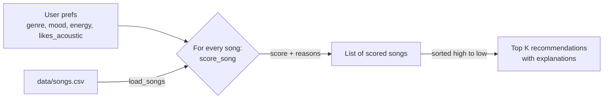

# 🎵 Music Recommender Simulation

## Project Summary

This project is a small, explainable **content-based music recommender** written in Python. It loads a 20-song catalog from `data/songs.csv`, compares every song to a user's "taste profile" (favorite genre, favorite mood, target energy and an acoustic preference), gives each song a score using a weighted "Algorithm Recipe", and prints the top 5 songs with a plain-English list of **reasons** for each score.

It runs entirely in the terminal (CLI-first), tests seven different listener profiles (including deliberately tricky ones), and supports a one-flag weight experiment (`--experiment`). The [Model Card](model_card.md) documents how it behaves, where it is biased, and what I learned.

---

## How The System Works

### How real recommenders do it

Platforms like Spotify, YouTube and TikTok mix two big ideas:

- **Collaborative filtering** uses *other people's behavior*. If many listeners who like song A also like song B, and you like A, you probably get B. It doesn't need to know anything about the music itself, only the behavior signals: plays, likes, skips, replays, saves, playlist adds, follows and listening time. It's powerful at scale but struggles with brand-new songs and users (the "cold start" problem).
- **Content-based filtering** uses *attributes of the songs themselves*: genre, mood, tempo, energy, valence (how happy it sounds), danceability, acousticness, and even audio or lyric embeddings. It recommends songs that look like what you already like, so it works on day one, but it tends to keep you in a bubble of similar-sounding music.

Real systems blend both, plus context (time of day, device, what you just skipped), then **rank** a large pool of candidates and re-rank for variety.

### What my version prioritizes

My simulation is **purely content-based**: there are no other users, only song attributes and one taste profile. It prioritizes a **genre** match first, then **mood**, then how **close** the song's energy is to what the listener wants (closeness, not "more is better"), with a small bonus for matching their acoustic vs. electronic preference. Every point awarded comes with a written reason, so the recommendation is fully explainable.

### Features used

**`Song`** (from `data/songs.csv`): `id`, `title`, `artist`, `genre`, `mood`, `energy` (0–1), `tempo_bpm`, `valence` (0–1), `danceability` (0–1), `acousticness` (0–1).
Scoring uses `genre`, `mood`, `energy` and `acousticness`; the other columns are loaded so they're available for future features.

**`UserProfile`** / `user_prefs` dict:

| Key | Example | Meaning |
|---|---|---|
| `genre` (`favorite_genre`) | `"lofi"` | favorite genre |
| `mood` (`favorite_mood`) | `"chill"` | favorite mood |
| `energy` (`target_energy`) | `0.35` | ideal energy level, 0.0 (calm) – 1.0 (intense) |
| `likes_acoustic` | `True` | prefers acoustic (True) or produced/electronic (False); optional |

### Algorithm Recipe (Scoring Rule, for one song)

| Rule | Points |
|---|---|
| Genre matches favorite genre | **+2.0** |
| Mood matches favorite mood | **+1.0** |
| Energy closeness | **+1.0 × (1 − \|song energy − target energy\|)** (perfect match = +1.0, opposite end = +0.0) |
| Acoustic fit (if given) | **+0.5 × acousticness** if `likes_acoustic`, otherwise **+0.5 × (1 − acousticness)** |

Maximum possible score is **4.5**. Genre and mood labels are compared case-insensitively (`" Jazz "` = `"jazz"`).

**Why genre is worth more than mood:** genre is the strongest "would I even listen to this?" filter for most people, while mood changes from day to day. Energy uses a *distance* instead of a raw value so a user who wants 0.4 energy is rewarded for a 0.42 song, not a 0.95 one.

### Ranking Rule (for the whole list)

A scoring rule only judges one song at a time. To *recommend*, you need a ranking rule too: `recommend_songs` calls `score_song` on **every** song in the catalog, sorts the results from highest to lowest score (ties broken alphabetically by title), and returns the top `k` (default 5). I used `sorted()` rather than `.sort()` because `sorted()` returns a new list and leaves the original catalog order unchanged, while `.sort()` modifies the list in place.

### Data flow



### Biases I expected going in

- **Genre over-dominance:** a +2.0 genre match can outweigh a great mood + energy match, so songs that fit the *vibe* but have a different genre label get buried.
- **Exact-label matching:** "indie pop" gets no credit for "pop", and a genre not in the catalog (e.g. k-pop) can never earn genre points.
- **Small, uneven catalog:** with only 20 songs and 3 of them pop, the same few tracks will show up for many different users.

---

## Getting Started

### Setup

1. Create a virtual environment (optional but recommended):

   ```bash
   python -m venv .venv
   source .venv/bin/activate      # Mac or Linux
   .venv\Scripts\activate         # Windows
   ```

2. Install dependencies

   ```bash
   pip install -r requirements.txt
   ```

3. Run the app:

   ```bash
   python -m src.main                        # all 7 profiles, default weights
   python -m src.main --profile "Chill Lofi" # just one profile
   python -m src.main --experiment           # weight-shift experiment
   ```

### Running Tests

```bash
pytest
```

The tests in `tests/test_recommender.py` cover CSV loading and numeric conversion, the scoring math, energy closeness, case-insensitive labels, sorted top-k ranking and the weight experiment.

---

## Sample Recommendation Output

Default `pop / happy / energy 0.8` profile (`python -m src.main --profile "Default Pop/Happy"`):

```
Loaded songs: 20
Weights: {'genre': 2.0, 'mood': 1.0, 'energy': 1.0, 'acoustic': 0.5}

========================================================================
Profile: Default Pop/Happy
Prefs:   genre='pop', mood='happy', energy=0.8
------------------------------------------------------------------------
1. Sunrise City - Neon Echo  [pop, happy]
   Score: 3.98
     * genre match: pop (+2.00)
     * mood match: happy (+1.00)
     * energy 0.82 vs target 0.80 (+0.98)
2. Cardio Queen - Max Pulse  [pop, energetic]
   Score: 2.92
     * genre match: pop (+2.00)
     * energy 0.88 vs target 0.80 (+0.92)
3. Gym Hero - Max Pulse  [pop, intense]
   Score: 2.87
     * genre match: pop (+2.00)
     * energy 0.93 vs target 0.80 (+0.87)
4. Rooftop Lights - Indigo Parade  [indie pop, happy]
   Score: 1.96
     * mood match: happy (+1.00)
     * energy 0.76 vs target 0.80 (+0.96)
5. Concrete Crown - Verse Theory  [hip-hop, confident]
   Score: 0.98
     * energy 0.78 vs target 0.80 (+0.98)
```

The top result is exactly what I'd expect: *Sunrise City* is the only song that is pop **and** happy **and** almost exactly the right energy.

---

## Stress Test: All Profiles

Output of `python -m src.main` for three "normal" listeners and three adversarial / edge-case profiles:

- **High-Energy Pop**, **Chill Lofi**, **Deep Intense Rock**: normal listeners.
- **Conflicted**: folk + *sad* mood but wants 0.9 energy (contradictory).
- **Ghost Genre (k-pop)**: a genre that doesn't exist in the catalog.
- **Middle-of-the-Road**: mid energy, messy capitalization/spaces, no acoustic preference.

### High-Energy Pop

```
========================================================================
Profile: High-Energy Pop
Prefs:   genre='pop', mood='happy', energy=0.9, likes_acoustic=False
------------------------------------------------------------------------
1. Sunrise City - Neon Echo  [pop, happy]
   Score: 4.33
     * genre match: pop (+2.00)
     * mood match: happy (+1.00)
     * energy 0.82 vs target 0.90 (+0.92)
     * produced/electronic fit 0.82 (+0.41)
2. Cardio Queen - Max Pulse  [pop, energetic]
   Score: 3.45
     * genre match: pop (+2.00)
     * energy 0.88 vs target 0.90 (+0.98)
     * produced/electronic fit 0.94 (+0.47)
3. Gym Hero - Max Pulse  [pop, intense]
   Score: 3.44
     * genre match: pop (+2.00)
     * energy 0.93 vs target 0.90 (+0.97)
     * produced/electronic fit 0.95 (+0.47)
4. Rooftop Lights - Indigo Parade  [indie pop, happy]
   Score: 2.19
     * mood match: happy (+1.00)
     * energy 0.76 vs target 0.90 (+0.86)
     * produced/electronic fit 0.65 (+0.33)
5. Laser Tide - Pulse Theory  [edm, energetic]
   Score: 1.44
     * energy 0.95 vs target 0.90 (+0.95)
     * produced/electronic fit 0.98 (+0.49)
```

### Chill Lofi

```
========================================================================
Profile: Chill Lofi
Prefs:   genre='lofi', mood='chill', energy=0.35, likes_acoustic=True
------------------------------------------------------------------------
1. Library Rain - Paper Lanterns  [lofi, chill]
   Score: 4.43
     * genre match: lofi (+2.00)
     * mood match: chill (+1.00)
     * energy 0.35 vs target 0.35 (+1.00)
     * acoustic fit 0.86 (+0.43)
2. Midnight Coding - LoRoom  [lofi, chill]
   Score: 4.29
     * genre match: lofi (+2.00)
     * mood match: chill (+1.00)
     * energy 0.42 vs target 0.35 (+0.93)
     * acoustic fit 0.71 (+0.35)
3. Focus Flow - LoRoom  [lofi, focused]
   Score: 3.34
     * genre match: lofi (+2.00)
     * energy 0.40 vs target 0.35 (+0.95)
     * acoustic fit 0.78 (+0.39)
4. Spacewalk Thoughts - Orbit Bloom  [ambient, chill]
   Score: 2.39
     * mood match: chill (+1.00)
     * energy 0.28 vs target 0.35 (+0.93)
     * acoustic fit 0.92 (+0.46)
5. Coffee Shop Stories - Slow Stereo  [jazz, relaxed]
   Score: 1.43
     * energy 0.37 vs target 0.35 (+0.98)
     * acoustic fit 0.89 (+0.45)
```

### Deep Intense Rock

```
========================================================================
Profile: Deep Intense Rock
Prefs:   genre='rock', mood='intense', energy=0.9, likes_acoustic=False
------------------------------------------------------------------------
1. Storm Runner - Voltline  [rock, intense]
   Score: 4.44
     * genre match: rock (+2.00)
     * mood match: intense (+1.00)
     * energy 0.91 vs target 0.90 (+0.99)
     * produced/electronic fit 0.90 (+0.45)
2. Gym Hero - Max Pulse  [pop, intense]
   Score: 2.44
     * mood match: intense (+1.00)
     * energy 0.93 vs target 0.90 (+0.97)
     * produced/electronic fit 0.95 (+0.47)
3. Cardio Queen - Max Pulse  [pop, energetic]
   Score: 1.45
     * energy 0.88 vs target 0.90 (+0.98)
     * produced/electronic fit 0.94 (+0.47)
4. Laser Tide - Pulse Theory  [edm, energetic]
   Score: 1.44
     * energy 0.95 vs target 0.90 (+0.95)
     * produced/electronic fit 0.98 (+0.49)
5. Iron Lung Choir - Ashen Gate  [metal, angry]
   Score: 1.42
     * energy 0.97 vs target 0.90 (+0.93)
     * produced/electronic fit 0.97 (+0.48)
```

### Conflicted (sad but 0.9 energy)

```
========================================================================
Profile: Conflicted (sad but 0.9 energy)
Prefs:   genre='folk', mood='sad', energy=0.9, likes_acoustic=True
------------------------------------------------------------------------
1. Paper Boats - Willow & Wren  [folk, sad]
   Score: 3.85
     * genre match: folk (+2.00)
     * mood match: sad (+1.00)
     * energy 0.30 vs target 0.90 (+0.40)
     * acoustic fit 0.90 (+0.45)
2. Rainy Day Ledger - Muddy Keys  [blues, sad]
   Score: 1.88
     * mood match: sad (+1.00)
     * energy 0.45 vs target 0.90 (+0.55)
     * acoustic fit 0.65 (+0.33)
3. Storm Runner - Voltline  [rock, intense]
   Score: 1.04
     * energy 0.91 vs target 0.90 (+0.99)
     * acoustic fit 0.10 (+0.05)
4. Rooftop Lights - Indigo Parade  [indie pop, happy]
   Score: 1.03
     * energy 0.76 vs target 0.90 (+0.86)
     * acoustic fit 0.35 (+0.17)
5. Cardio Queen - Max Pulse  [pop, energetic]
   Score: 1.01
     * energy 0.88 vs target 0.90 (+0.98)
     * acoustic fit 0.06 (+0.03)
```

### Ghost Genre (k-pop)

```
========================================================================
Profile: Ghost Genre (k-pop)
Prefs:   genre='k-pop', mood='happy', energy=0.7, likes_acoustic=False
------------------------------------------------------------------------
1. Sunrise City - Neon Echo  [pop, happy]
   Score: 2.29
     * mood match: happy (+1.00)
     * energy 0.82 vs target 0.70 (+0.88)
     * produced/electronic fit 0.82 (+0.41)
2. Rooftop Lights - Indigo Parade  [indie pop, happy]
   Score: 2.27
     * mood match: happy (+1.00)
     * energy 0.76 vs target 0.70 (+0.94)
     * produced/electronic fit 0.65 (+0.33)
3. Concrete Crown - Verse Theory  [hip-hop, confident]
   Score: 1.38
     * energy 0.78 vs target 0.70 (+0.92)
     * produced/electronic fit 0.92 (+0.46)
4. Night Drive Loop - Neon Echo  [synthwave, moody]
   Score: 1.34
     * energy 0.75 vs target 0.70 (+0.95)
     * produced/electronic fit 0.78 (+0.39)
5. Cardio Queen - Max Pulse  [pop, energetic]
   Score: 1.29
     * energy 0.88 vs target 0.70 (+0.82)
     * produced/electronic fit 0.94 (+0.47)
```

### Middle-of-the-Road

```
========================================================================
Profile: Middle-of-the-Road
Prefs:   genre='  Jazz ', mood='RELAXED', energy=0.5
------------------------------------------------------------------------
1. Coffee Shop Stories - Slow Stereo  [jazz, relaxed]
   Score: 3.87
     * genre match: jazz (+2.00)
     * mood match: relaxed (+1.00)
     * energy 0.37 vs target 0.50 (+0.87)
2. Dusty Porch Lights - June Hollow  [country, nostalgic]
   Score: 0.98
     * energy 0.48 vs target 0.50 (+0.98)
3. Rainy Day Ledger - Muddy Keys  [blues, sad]
   Score: 0.95
     * energy 0.45 vs target 0.50 (+0.95)
4. Velvet After Hours - Satin Avenue  [r&b, romantic]
   Score: 0.95
     * energy 0.55 vs target 0.50 (+0.95)
5. Midnight Coding - LoRoom  [lofi, chill]
   Score: 0.92
     * energy 0.42 vs target 0.50 (+0.92)
```

---

## Experiments You Tried

### Weight Shift: double energy, halve genre

I changed the weights from `genre 2.0 / energy 1.0` to `genre 1.0 / energy 2.0` (`EXPERIMENT_WEIGHTS` in `src/recommender.py`, run with `--experiment`).

| Profile | Default top 5 | Experiment top 5 | What changed |
|---|---|---|---|
| Default Pop/Happy | Sunrise City, Cardio Queen, Gym Hero, Rooftop Lights, Concrete Crown | Sunrise City, Rooftop Lights, Cardio Queen, Gym Hero, Concrete Crown | Rooftop Lights (indie pop, happy) jumps #4 to #2; Gym Hero falls to #4 |
| High-Energy Pop | Sunrise City, Cardio Queen, Gym Hero, Rooftop Lights, Laser Tide | Sunrise City, Cardio Queen, Gym Hero, Rooftop Lights, Storm Runner | Storm Runner (rock) replaces Laser Tide at #5; top 3 unchanged |
| Chill Lofi | Library Rain, Midnight Coding, Focus Flow, Spacewalk Thoughts, Coffee Shop Stories | Library Rain, Midnight Coding, Spacewalk Thoughts, Focus Flow, Coffee Shop Stories | Spacewalk Thoughts (ambient) passes Focus Flow (lofi) for #3 |
| Deep Intense Rock | Storm Runner, Gym Hero, Cardio Queen, Laser Tide, Iron Lung Choir | Storm Runner, Gym Hero, Cardio Queen, Laser Tide, Iron Lung Choir | Same order; Storm Runner's lead shrinks from 2.00 to 1.01 points |
| Conflicted (sad but 0.9 energy) | Paper Boats, Rainy Day Ledger, Storm Runner, Rooftop Lights, Cardio Queen | Paper Boats, Rainy Day Ledger, Storm Runner, Cardio Queen, Gym Hero | Gym Hero enters at #5; sad songs still win, gap narrows |
| Ghost Genre (k-pop) | Sunrise City, Rooftop Lights, Concrete Crown, Night Drive Loop, Cardio Queen | Rooftop Lights, Sunrise City, Concrete Crown, Night Drive Loop, Cardio Queen | Rooftop Lights and Sunrise City swap #1/#2 (energy closer to 0.7) |
| Middle-of-the-Road | Coffee Shop Stories, Dusty Porch Lights, Rainy Day Ledger, Velvet After Hours, Midnight Coding | Coffee Shop Stories, Dusty Porch Lights, Rainy Day Ledger, Velvet After Hours, Midnight Coding | No change in order |

**Result: more *different* than more *accurate*.** The #1 song never changed for any profile. Where it helped: *Rooftop Lights* (indie pop, happy) jumped to #2 for the pop/happy user, which honestly fits the vibe better than *Gym Hero*, and *Spacewalk Thoughts* (ambient, chill) passed *Focus Flow* (lofi, focused) for the chill user. Where it hurt: rock (*Storm Runner*) showed up for the High-Energy Pop user just because its energy is high. For the Conflicted profile, the sad folk song still won, but the gap shrank a lot (3.25 vs 2.42), so energy started to matter more. I kept the original weights as the default because genre is still a useful filter.

### Edge-case observations

- **Conflicting preferences** don't break anything, but the system silently picks a side: genre + mood (3.0 points) beat energy (max 1.0), so the user got a quiet 0.30-energy song even though they asked for 0.9.
- **Unknown genre** (k-pop) means every song loses 2.0 possible points and the ranking falls back on mood + energy. It still gave sensible pop/happy picks, but by luck rather than design.
- **Messy input** (`"  Jazz "`, `"RELAXED"`) is handled by normalizing labels, but after the single jazz song, the remaining 4 picks are decided only by energy, so they feel random (country, blues, r&b, lofi).

---

## Limitations and Risks

- It only works on a tiny 20-song catalog, so the same few songs (*Gym Hero*, *Cardio Queen*) appear in many lists.
- Genre and mood are exact string matches: no partial credit for related genres ("indie pop" ≈ "pop") or similar moods ("chill" ≈ "relaxed").
- It ignores tempo, valence, danceability, lyrics, language, artist and listening history.
- It can't learn: there's no feedback from skips or likes, and no collaborative signal from other users.
- It over-favors whatever genre has more songs in the catalog and creates a filter bubble around the user's stated genre.

See the [Model Card](model_card.md) for a deeper discussion.

---

## Reflection

Read the full [**Model Card**](model_card.md).

Building this showed me that a "recommendation" is really just two small steps repeated: a **scoring rule** that turns one song's data into a number, and a **ranking rule** that sorts every song by that number. Even with four features and hand-picked weights, the output *felt* like a real recommendation, because the top result for every normal profile was the song I would have picked by hand. The reasons list was the most useful part: seeing "genre match (+2.00)" next to every pop song made it obvious *why* the system behaved the way it did, which is something real apps rarely show you.

The bias showed up faster than I expected. The weights I chose are a value judgment ("genre matters twice as much as mood"), and that single choice decided who wins in almost every list. Users whose taste doesn't fit the catalog's labels, like someone who loves k-pop or someone whose mood and energy don't line up, get worse results without any warning. At real-world scale, the same kind of choice could quietly decide which artists get heard and which never get surfaced.
